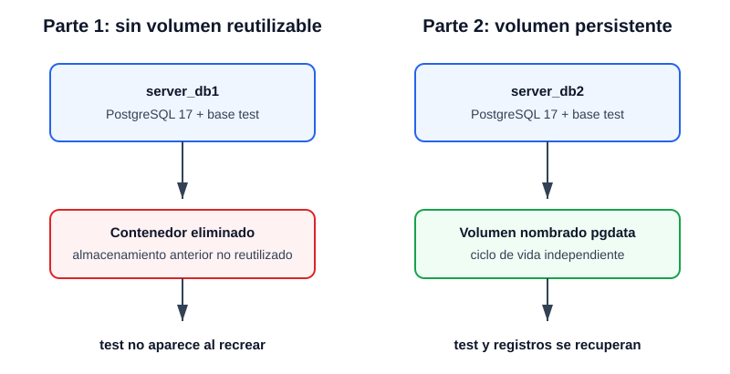

# Práctica N.º 3: Creación de volúmenes para persistir bases de datos PostgreSQL

## 1. Título

**Análisis de persistencia de una base de datos PostgreSQL en Docker, sin y con un volumen nombrado**

### Introducción

La contenerización facilita la instalación y el despliegue reproducible de un sistema gestor de bases de datos. Sin embargo, la vida útil de un contenedor no debe confundirse con la vida útil de la información que procesa. Esta práctica propone observar esa diferencia mediante dos pruebas controladas con PostgreSQL 17. En la primera se crea una base de datos dentro de un contenedor que luego se elimina y se recrea sin reutilizar su almacenamiento. En la segunda se monta un volumen nombrado, `pgdata`, en el directorio de datos de PostgreSQL y se vuelve a crear el contenedor usando el mismo volumen.

El procedimiento se ejecutó desde PowerShell usando `psql` dentro del propio contenedor, por lo que no dependió de un cliente gráfico. Se comprobó Docker Desktop 4.97.0 y Docker Engine 29.9.2 sobre WSL 2. Las dos pruebas se ejecutaron con PostgreSQL 17 y sus resultados se registraron en `evidencias/01-ejecucion-practica.txt`.

## 2. Tiempo de duración

- Investigación, ejecución y documentación: 120 minutos.
- Ejecución prevista de las dos pruebas, una vez instalado Docker: 25 a 35 minutos.
- Estado al 26 de octubre de 2026: ejecución experimental completada.

## 3. Fundamentos

Una **imagen Docker** es una plantilla inmutable compuesta por capas que contiene una aplicación y sus dependencias. Un **contenedor** es una instancia ejecutable de esa imagen y añade una capa de escritura propia. PostgreSQL puede ejecutarse de forma aislada usando su imagen oficial, mientras Docker se encarga de crear el proceso, la red y el sistema de archivos necesarios. La variable `POSTGRES_PASSWORD` inicializa la contraseña del superusuario de la imagen oficial. Para esta práctica se fija la etiqueta `postgres:17`, lo que evita depender de los cambios de una etiqueta flotante y permite usar el directorio de datos `/var/lib/postgresql/data`, indicado para PostgreSQL 17 y versiones anteriores de esa imagen.

La capa de escritura del contenedor pertenece a ese contenedor. Al eliminarlo, esa capa deja de estar disponible para una instancia nueva. Una base de datos escrita allí no se restaura solo por asignar el mismo nombre al siguiente contenedor, porque el nombre es un identificador y no un mecanismo de recuperación. La imagen oficial de PostgreSQL declara almacenamiento para sus datos y Docker puede crear un volumen anónimo. En esta práctica, la expresión “sin volumen” se interpreta como **sin un volumen nombrado y reutilizable**. Al eliminar `server_db1` se utiliza `docker rm --volumes` para retirar también el volumen anónimo asociado; el segundo contenedor empieza con un clúster limpio. Este detalle evita concluir de forma imprecisa que el nombre del contenedor controla los datos.

Un **volumen Docker** es un almacén administrado por el motor con ciclo de vida independiente del contenedor que lo utiliza. `docker volume create pgdata` crea un volumen nombrado. La opción `--mount type=volume,source=pgdata,target=/var/lib/postgresql/data` lo expone en el directorio donde PostgreSQL 17 guarda el clúster de datos. Cuando `server_db2` se elimina sin la opción `--volumes`, `pgdata` permanece. El nuevo `server_db2` monta el mismo contenido y PostgreSQL encuentra sus archivos de catálogo, tablas y registros. El volumen tampoco reemplaza una estrategia de respaldo: un borrado accidental, la corrupción lógica o la eliminación explícita del volumen también afectan la información.

PostgreSQL organiza los datos en bases, esquemas, tablas, filas y otros objetos. `CREATE DATABASE test` crea una base independiente. La tabla `customer` usa una columna `id` generada automáticamente como clave primaria, `fullname` como texto obligatorio y `status` como valor booleano. `psql` permite ejecutar SQL y devolver resultados en la terminal. Las consultas al catálogo `pg_database` y `SELECT COUNT(*)` convierten la observación en una verificación explícita: la Parte 1 debe devolver una cadena vacía para `test` después de recrear el contenedor, mientras que la Parte 2 debe devolver `test` y exactamente dos filas después de montar nuevamente `pgdata`.



*Figura 1. Comportamiento conceptual de las dos pruebas. Ancho: 800 px.*

## 4. Conocimientos previos

Para desarrollar la práctica se requieren los siguientes conocimientos:

- Uso básico de PowerShell o de una terminal equivalente.
- Conceptos de imagen, contenedor, puerto, variable de entorno y volumen en Docker.
- Instrucciones SQL `CREATE DATABASE`, `CREATE TABLE`, `INSERT` y `SELECT`.
- Manejo básico del cliente `psql` o de un administrador gráfico como DataGrip o TablePlus.
- Lectura de estados de salida y archivos de evidencia.
- Operaciones básicas de Git y GitHub para versionar y publicar el informe.

## 5. Objetivos a alcanzar

### Objetivo general

Comprobar experimentalmente cómo un volumen nombrado permite conservar una base de datos PostgreSQL cuando se elimina y recrea su contenedor Docker.

### Objetivos específicos

- Verificar la disponibilidad del cliente y del motor Docker antes de crear recursos.
- Crear y administrar contenedores PostgreSQL 17 mediante comandos reproducibles.
- Crear la base `test`, la tabla `customer` y registros de prueba por medio de SQL.
- Demostrar la pérdida del almacenamiento no reutilizado al recrear `server_db1`.
- Crear y montar el volumen nombrado `pgdata` en `server_db2`.
- Verificar que la base, la tabla y sus registros permanecen después de recrear `server_db2`.
- Diferenciar las acciones de detener un contenedor, eliminarlo y eliminar un volumen.
- Producir evidencia trazable sin modificar contenedores o volúmenes ajenos.

## 6. Equipo necesario

| Recurso | Selección o estado |
|---|---|
| Computador | Arquitectura de 64 bits |
| Sistema operativo diagnosticado | Microsoft Windows NT 10.0.26200.0; el sistema reportó Windows 10 Home de 64 bits |
| Virtualización | Requerida para WSL 2 y contenedores Linux |
| WSL | Versión 2.6.3; Ubuntu y `docker-desktop` ejecutados con WSL 2 |
| Docker Desktop | 4.97.0, instalado por usuario |
| Docker Engine/CLI | 29.9.2, contexto `desktop-linux` |
| Imagen de base de datos | `postgres:17` |
| Cliente SQL | `psql`, incluido en la imagen oficial |
| Control de versiones | Git instalado |
| Editor | Cualquier editor compatible con Markdown |

### Instalación y configuración realizada

WSL 2 ya se encontraba instalado. Se comprobó con `wsl --version` y `wsl --list --verbose`; Ubuntu aparecía en versión 2. Docker Desktop se instaló y se inició con el backend WSL 2. En otro equipo, los comandos de instalación serían:

```powershell
wsl --install
wsl --update
```

Docker Desktop puede instalarse mediante Windows Package Manager:

```powershell
winget install --exact --id Docker.DockerDesktop --accept-package-agreements --accept-source-agreements
```

Después de abrir Docker Desktop y esperar el arranque del motor, se verificó con:

```powershell
docker version
docker run --rm hello-world
```

`docker version` mostró las secciones Client y Server con la versión 29.9.2. Esta salida forma parte de la transcripción de la práctica.

## 7. Material de apoyo

- Plantilla oficial de informe del repositorio `maguaman2/informe-tendencias`.
- Documentación oficial de volúmenes y almacenamiento de Docker.
- Descripción y notas de compatibilidad de la imagen oficial de PostgreSQL.
- Documentación oficial de PostgreSQL 17 para SQL y `psql`.
- Guía oficial de Microsoft para instalar WSL.
- Script reproducible [`scripts/practica.ps1`](scripts/practica.ps1).
- Archivo SQL [`sql/customer.sql`](sql/customer.sql).

## 8. Procedimiento

### 8.1. Verificación del entorno

Se ejecutaron `wsl --version`, `wsl --list --verbose` y `docker version`. Ubuntu y `docker-desktop` aparecieron con WSL 2; Docker mostró las secciones Client y Server con la versión 29.9.2 y el contexto `desktop-linux`. Con el motor operativo se continuó con las dos partes de la práctica. Los resultados están en [`evidencias/01-ejecucion-practica.txt`](evidencias/01-ejecucion-practica.txt).

### 8.2. Controles de seguridad

Antes de crear recursos, el script comprueba que no existan los contenedores `server_db1`, `server_db2` ni el volumen `pgdata`. Si uno existe, termina sin eliminarlo para proteger posibles datos previos. También guarda una transcripción en `evidencias/01-ejecucion-practica.txt`.

```powershell
Set-ExecutionPolicy -Scope Process Bypass
.\scripts\practica.ps1
```

La modificación de la política se limita al proceso actual. El script fija `postgres:17` y usa una contraseña de laboratorio. En un sistema real la contraseña debe almacenarse como secreto y no incluirse en el repositorio.

### 8.3. Parte 1: PostgreSQL sin volumen nombrado reutilizable

**Paso 1. Crear `server_db1`.**

```powershell
docker run --name server_db1 --detach `
  --env "POSTGRES_PASSWORD=PgLab_2026!" `
  --publish 5432:5432 `
  postgres:17
```

`--name` asigna el nombre; `--detach` ejecuta en segundo plano; `--env` proporciona la contraseña inicial; `--publish` expone PostgreSQL en `localhost:5432`. `pg_isready -U postgres` se ejecuta hasta que el servidor acepta conexiones.

**Paso 2. Crear la base de datos.**

```powershell
docker exec server_db1 psql -U postgres -v ON_ERROR_STOP=1 -c "CREATE DATABASE test;"
```

`docker exec` ejecuta `psql` dentro del contenedor. `ON_ERROR_STOP` obliga a detener el procedimiento si SQL devuelve un error.

**Paso 3. Crear la tabla e insertar dos registros.**

```sql
CREATE TABLE customer (
    id INTEGER GENERATED ALWAYS AS IDENTITY PRIMARY KEY,
    fullname VARCHAR(120) NOT NULL,
    status BOOLEAN NOT NULL DEFAULT TRUE
);

INSERT INTO customer (fullname, status)
VALUES ('Ana Torres', TRUE), ('Luis Mendoza', FALSE);
```

El archivo completo se canaliza a `psql -d test`. La verificación se realiza con:

```powershell
docker exec server_db1 psql -U postgres -d test -c "TABLE customer;"
```

**Evidencia verificada:** `psql` devolvió dos filas con los nombres Ana Torres y Luis Mendoza y estados `t` y `f`, respectivamente.

**Paso 4. Detener y eliminar el contenedor.**

```powershell
docker stop server_db1
docker rm --volumes server_db1
```

`stop` finaliza PostgreSQL de manera ordenada. `rm --volumes` elimina el contenedor y el volumen anónimo asociado por la imagen; no actúa sobre volúmenes nombrados de otros proyectos.

**Paso 5. Recrear y verificar la ausencia de `test`.**

Se repite `docker run` con el mismo nombre. Un nombre idéntico no enlaza el almacenamiento anterior. La prueba consulta el catálogo:

```powershell
docker exec server_db1 psql -U postgres -tAc "SELECT datname FROM pg_database WHERE datname = 'test';"
```

**Resultado verificado:** la consulta devolvió una salida vacía y el script registró `COMPROBADO: la base de datos test no existe en el contenedor recreado.`

### 8.4. Parte 2: PostgreSQL con volumen nombrado

Después de detener `server_db1` para liberar el puerto 5432, se crea el volumen:

```powershell
docker volume create pgdata
docker volume inspect pgdata
```

`create` crea el almacén y `inspect` permite verificar nombre, controlador y punto de montaje administrado por Docker.

**Paso 1. Crear `server_db2` con `pgdata`.**

```powershell
docker run --name server_db2 --detach `
  --env "POSTGRES_PASSWORD=PgLab_2026!" `
  --publish 5432:5432 `
  --mount type=volume,source=pgdata,target=/var/lib/postgresql/data `
  postgres:17
```

`--mount` asocia de forma explícita `pgdata` con el directorio de datos compatible con PostgreSQL 17. Después de esperar con `pg_isready`, se repiten `CREATE DATABASE test`, la creación de `customer`, los dos `INSERT` y la consulta `TABLE customer`.

**Evidencia verificada:** se creó `test`, `customer` y dos registros; la consulta mostró ambas filas antes de eliminar `server_db2`.

**Paso 2. Eliminar únicamente el contenedor.**

```powershell
docker stop server_db2
docker rm server_db2
docker volume inspect pgdata
```

Aquí no se usa `--volumes` y tampoco se ejecuta `docker volume rm pgdata`. La inspección posterior debe confirmar que el volumen continúa disponible.

**Paso 3. Recrear `server_db2` con el mismo volumen.**

Se repite el comando `docker run` con el mismo `--mount`. Luego se ejecutan tres verificaciones:

```powershell
docker exec server_db2 psql -U postgres -tAc "SELECT datname FROM pg_database WHERE datname = 'test';"
docker exec server_db2 psql -U postgres -d test -c "TABLE customer;"
docker exec server_db2 psql -U postgres -d test -tAc "SELECT COUNT(*) FROM customer;"
```

**Resultado verificado:** la primera consulta devolvió `test`, la segunda mostró los registros y la tercera devolvió `2`. El script registró `COMPROBADO: test, customer y sus 2 registros persistieron en pgdata.`

### 8.5. Conexión opcional desde un administrador gráfico

Una vez levantado uno de los contenedores, DataGrip, TablePlus, DBeaver o pgAdmin puede usar estos parámetros:

| Parámetro | Valor |
|---|---|
| Host | `localhost` |
| Puerto | `5432` |
| Usuario | `postgres` |
| Contraseña de laboratorio | `PgLab_2026!` |
| Base inicial | `postgres` o `test`, una vez creada |

La práctica no depende del cliente gráfico porque todas las operaciones están disponibles mediante `psql` y quedan registradas en la transcripción.

## 9. Resultados esperados

### 9.1. Estado de verificación

| Evidencia o prueba | Estado | Sustento |
|---|---|---|
| Revisión de la plantilla oficial | Verificada | Se conservaron sus diez apartados y la exigencia de fundamentos e imagen |
| Verificación de Docker | Verificada | Client y Server 29.9.2; Docker Desktop 4.97.0 |
| Creación y consulta en `server_db1` | Verificada | Dos registros consultados mediante `psql` |
| Pérdida de `test` al recrear `server_db1` | Verificada | Consulta al catálogo sin coincidencias y aserción superada |
| Creación de `pgdata` y `server_db2` | Verificada | Volumen local inspeccionado después de eliminar el contenedor |
| Persistencia de dos registros | Verificada | `test` recuperada y conteo final igual a `2` |

### 9.2. Comparación de las pruebas

| Aspecto | Parte 1: almacenamiento no reutilizado | Parte 2: volumen `pgdata` |
|---|---|---|
| Acoplamiento | Datos ligados al almacenamiento asociado a la instancia eliminada | Datos gestionados fuera del ciclo de vida del contenedor |
| Recreación | El nombre `server_db1` no recupera el clúster anterior | El montaje explícito recupera el mismo clúster |
| Base `test` después de recrear | Debe estar ausente | Debe existir |
| Tabla y filas | No deben estar disponibles | Deben conservarse dos filas |
| Operación de eliminación | `docker rm --volumes server_db1` | `docker rm server_db2`, sin borrar `pgdata` |
| Uso recomendado | Datos temporales o laboratorios desechables | Bases que deben sobrevivir despliegues del contenedor |

### 9.3. Análisis de resultados

El resultado obtenido coincide con el modelo de almacenamiento documentado por Docker: el almacenamiento no reutilizado de `server_db1` no permitió recuperar `test`, mientras que el volumen nombrado conservó los datos fuera del ciclo de vida de `server_db2`. La transcripción muestra la inserción inicial, la ausencia de `test` en la Parte 1 y la recuperación de dos filas en la Parte 2.

El uso de comprobaciones automáticas reduce errores de interpretación. Una salida vacía solo se acepta si `psql` termina con código correcto; un fallo de conexión no se confunde con una base ausente. De manera equivalente, la persistencia no se da por válida solo porque el contenedor inicia: el script consulta `pg_database`, lee `customer` y comprueba su conteo. Esta combinación permite distinguir la disponibilidad del servicio de la integridad de los datos esperados.

### 9.4. Conclusiones

1. El nombre de un contenedor no representa ni recupera su almacenamiento; identifica una instancia administrada por Docker.
2. Un volumen nombrado permite separar la vida útil de los datos de la vida útil del contenedor que ejecuta PostgreSQL.
3. Detener un contenedor, eliminarlo y eliminar su volumen son operaciones distintas y deben aplicarse conscientemente.
4. La persistencia debe validarse mediante consultas a la base y no solamente mediante el estado `running` del contenedor.
5. La demostración se completó con Docker Engine 29.9.2 y PostgreSQL 17, y la evidencia confirma los dos comportamientos previstos.

### 9.5. Recomendaciones

- Verificar las secciones Client y Server de `docker version` antes de repetir la práctica.
- Mantener fijada la versión `postgres:17`; si se cambia a PostgreSQL 18 o posterior, revisar las notas de `PGDATA` y el destino del volumen.
- Usar secretos o variables protegidas para contraseñas reales.
- Mantener respaldos independientes del volumen y probar su restauración.
- Evitar `docker volume prune`, `docker system prune --volumes` o eliminaciones globales en equipos con otros proyectos.
- Revisar `docker volume inspect pgdata` antes de cualquier operación destructiva.
- Añadir la transcripción y capturas reales al repositorio después de ejecutar el script.

## 10. Bibliografía

- Docker, Inc. (2026). *Volumes*. Docker Documentation. https://docs.docker.com/engine/storage/volumes/ (consultado el 26 de octubre de 2026).
- Docker, Inc. (2026). *Running containers: filesystem mounts*. Docker Documentation. https://docs.docker.com/engine/containers/run/ (consultado el 26 de octubre de 2026).
- Docker, Inc. (2026). *Install Docker Desktop on Windows*. Docker Documentation. https://docs.docker.com/desktop/setup/install/windows-install/ (consultado el 26 de octubre de 2026).
- Docker Official Images. (2026). *Postgres—Official Image*. Docker Hub. https://hub.docker.com/_/postgres (consultado el 26 de octubre de 2026).
- Microsoft. (2026). *Install WSL*. Microsoft Learn. https://learn.microsoft.com/windows/wsl/install (consultado el 26 de octubre de 2026).
- PostgreSQL Global Development Group. (2025). *PostgreSQL 17 documentation: SQL commands*. https://www.postgresql.org/docs/17/sql-commands.html (consultado el 26 de octubre de 2026).
- PostgreSQL Global Development Group. (2025). *PostgreSQL 17 documentation: psql*. https://www.postgresql.org/docs/17/app-psql.html (consultado el 26 de octubre de 2026).
- Guaman, M. (s. f.). *Informe tendencias: informe.md* [Plantilla de informe]. GitHub. https://github.com/maguaman2/informe-tendencias (consultado el 26 de octubre de 2026).

